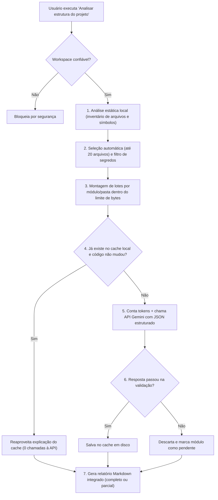

# Como funciona o Legacy AI agora (Resumo das mudanças)

Este documento explica, em palavras simples, o que havia antes, o que foi **adicionado** ou **alterado** no projeto e como a extensão funciona de ponta a ponta depois da integração com o **Google Gemini**.

---

## 1. O que mudou na prática? (Antes vs. Depois)

- **Antes**: A extensão apenas lia as pastas e arquivos JavaScript/TypeScript do projeto (análise estática, ou seja, leitura sem executar o código) e gerava um inventário técnico listando arquivos, funções, classes, imports e exports.
- **Agora**: Além de continuar gerando todo esse inventário técnico local, a extensão **seleciona os arquivos mais importantes**, **verifica um cache local** (memória guardada em disco para não repetir trabalho), **conversa com o Google Gemini** respeitando os limites da sua conta gratuita e entrega um relatório único com a seção **"Entendendo o projeto"**, explicando em português simples o que cada módulo faz.

---

## 2. Como o sistema funciona passo a passo

### Detalhamento do fluxo:

1. **Verificação de segurança (Workspace Trust)**: A extensão só roda se você marcar a pasta aberta como confiável no VS Code.
2. **Inventário estático**: Um processo separado (*worker*, um trabalhador em segundo plano para não travar a tela do editor) lê os arquivos aceitos e mapeia funções, classes, imports, exports, dependências e erros de sintaxe.
3. **Seleção inteligente e filtro de privacidade**: O sistema escolhe no máximo **20 arquivos** mais relevantes (priorizando pontos de entrada e arquivos muito importados) e descarta qualquer arquivo com indício de senha, chave ou conteúdo sensível.
4. **Fatiamento por módulos**: Os arquivos selecionados são agrupados por pasta/módulo. Se um arquivo for muito grande, ele é dividido respeitando a estrutura do código (usando a AST — *Árvore Sintática Abstrata*, que é o mapa gramatical do código) para não cortar funções no meio.
5. **Checagem no cache em disco**: Antes de gastar internet ou cota da API, o sistema calcula uma impressão digital (*hash* SHA-256) do código do módulo, das dependências dele, do modelo e das instruções. Se já tiver uma explicação válida guardada para aquela impressão digital exata, ele a reutiliza na hora.
6. **Consulta controlada ao Gemini**: Para os módulos que faltam:
   - Primeiro, consulta quantos tokens (*pedaços de texto/código*) o lote consome (`countTokens`).
   - Respeita seus limites por minuto (RPM e TPM) e sua cota diária (RPD), fazendo pausas automáticas se precisar.
   - Pede a explicação obrigando o modelo a responder em **JSON estruturado** (*formato rígido de dados*, usando `responseMimeType` e `responseSchema`), evitando respostas soltas em texto comum.
7. **Validação estrita e proteção do relatório**: A resposta da IA é conferida campo por campo (módulo, responsabilidade, componentes, relações, linhas citadas, inferências e limitações). Se estiver tudo certo, é salva no cache. Na hora de escrever o Markdown final, todo texto vindo da IA passa por limpeza (`safe()`) para impedir injeção de HTML ou links maliciosos.
8. **Estado honesto de conclusão**: O relatório só recebe o selo **`completo`** quando 100% dos módulos selecionados têm explicações válidas. Se faltar algum (por cancelamento, cota esgotada ou erro), ele marca **`parcial`** e lista o motivo exato.

---

## 3. O que foi adicionado (Arquivos novos)

### Núcleo da integração com IA (`src/gemini/`)

| Arquivo | Para que serve (em palavras simples) |
| :--- | :--- |
| `src/gemini/setup.ts` | Cria as caixinhas seguras para você colar ou apagar sua chave de API do Gemini, guardando-a no cofre criptografado do VS Code (`SecretStorage`). |
| `src/gemini/configuration.ts` | Lê e confere as configurações do usuário (nome do modelo e limites de cota), normalizando prefixos como `models/`. |
| `src/gemini/authorization.ts` | Ranqueia os arquivos mais importantes (limite de 20) e bloqueia arquivos sensíveis (como `.env`, chaves ou tokens). |
| `src/gemini/prepareContext.ts` | Organiza os arquivos em lotes por módulo, divide arquivos grandes pela AST e garante que nenhum lote ultrapasse o limite de tamanho. |
| `src/gemini/httpClient.ts` | Faz a ligação direta via HTTPS nativo do Node.js com os servidores do Google (sem instalar pacotes externos), com timeout de 30s e envio da chave apenas no cabeçalho HTTP. |
| `src/gemini/runBatches.ts` | Controla a fila sequencial de chamadas, o gasto de tokens/requisições por minuto, a cota diária (no horário do Pacífico) e as novas tentativas automáticas em caso de instabilidade. |
| `src/gemini/explanations.ts` | Guarda a instrução para a IA explicar em português simples, o esquema JSON oficial esperado e o validador que confere se a resposta faz sentido e cita apenas arquivos/linhas reais do lote. |
| `src/gemini/explanationCache.ts` | Gerencia o cache em disco fora do repositório (`globalStorageUri`), separado por projeto, sem guardar cópia do código-fonte e com limpeza automática se lotar ou corromper. |
| `src/gemini/explanationOrchestrator.ts` | Coordena tudo: olha o cache, separa o que falta, chama o executor de lotes, valida e salva cada resultado válido imediatamente. |

### Documentação, regras e testes novos

- **Governança e planejamento**: `AGENTS.md` (regras de segurança, validação e atualização do plano) e `docs/plano-integracao-gemini.md` (checklist completo das 6 etapas).
- **Exemplo de inventário**: `docs/results/legacy-ai-inventory.md` (registro de saída gerada sobre o próprio projeto).
- **Novas suítes de testes**:
  - `test/gemini.test.cjs` (seleção de arquivos, filtros de privacidade e validação de configuração).
  - `test/gemini-context.test.cjs` (divisão de módulos, fatiamento de AST e orçamento em bytes).
  - `test/gemini-http.test.cjs` (simulação de rede, contagem de tokens, janelas de cota, retries e cancelamento).
  - `test/gemini-cache.test.cjs` (reutilização, invalidação por mudança em dependência, corrupção e isolamento entre projetos).
  - `test/gemini-report.test.cjs` (relatórios completos, parciais, cancelados e proteção contra conteúdo malicioso vindo da IA).

---

## 4. O que foi alterado (Arquivos existentes)

| Arquivo | O que mudou nele |
| :--- | :--- |
| `package.json` | Adicionou os comandos de configurar/remover chave do Gemini e limpar cache, além das configurações `legacyAi.gemini.*` (modelo, cotas e limites locais). |
| `src/extension.ts` | Conectou a análise estática ao orquestrador do Gemini dentro do comando `legacyAi.analyze`, com barra de progresso cancelável, avisos na tela e tradução clara dos motivos de parada. |
| `src/analysis/renderInventory.ts` | Adicionou a seção **Entendendo o projeto** no relatório Markdown, o cabeçalho explícito de **completo** vs **parcial** (com módulos pendentes) e a função `safe()` para escapar HTML e pontuação Markdown perigosa. |
| `README.md` e `docs/como-iniciar.md` | Atualizados para explicar o novo fluxo com IA, avisos de privacidade, uso do `SecretStorage`, configuração do `gemini-2.5-flash-lite` e teste de cache com F5. |
| `test/extension.test.cjs` | Ajustado para validar o novo fluxo integrado da extensão. |

---

## 5. Como a sua privacidade e cota ficam protegidas

- **Chave protegida**: Sua chave nunca vai para arquivos do projeto (`settings.json` ou repositório); ela fica criptografada no `SecretStorage` do VS Code.
- **Envio mínimo e filtrado**: Apenas trechos de código elegíveis (no máximo 20 arquivos) vão para a API; arquivos com padrões de credenciais são descartados antes.
- **Sem código no cache**: O cache em disco guarda apenas as explicações geradas e identificadores criptográficos (*hashes*), nunca uma cópia do seu código-fonte, e fica fora da pasta do projeto.
- **Economia de cota**: Na segunda execução sem mudar o código, o sistema lê tudo do cache local sem gastar nenhuma chamada da sua cota no Google AI Studio.
